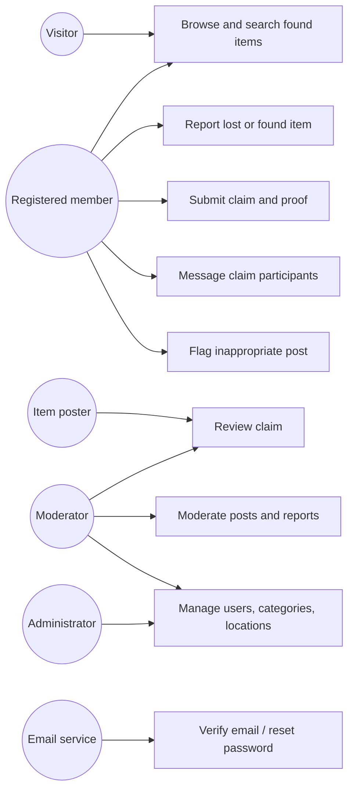

# DU Lost & Found — Course Deliverables

This document covers the API reference, verification checklist, use cases, claim-flow diagrams, report text, demo plan, viva preparation, and deployment notes for the application in this folder.

## 1. API reference

Base URL for local development: `http://localhost:3000/api`. Requests and responses use JSON except item create/update, which use `multipart/form-data`. Browser authentication uses the HttpOnly session cookie set at login; endpoints marked **Member** require login, and **Moderator** or **Admin** endpoints also enforce the stated role on the server.

| Method and route | Access | Request | Successful response |
|---|---|---|---|
| `GET /health` | Public | — | Service and database status |
| `POST /auth/register` | Public | `name`, `email`, `password`; optional `phone`, `affiliation`, `departmentOrHall`, `campusId`, `locale` | `201`, account summary and verification status |
| `POST /auth/login` | Public | `email`, `password` | `200`, user summary; sets session cookie |
| `POST /auth/logout` | Public/session | — | `200`; clears session cookie |
| `POST /auth/verify-email` | Public | `token` | `200`, verification result |
| `POST /auth/forgot-password` | Public | `email` | `200`, non-enumerating recovery response |
| `POST /auth/reset-password` | Public | `token`, `password` | `200`, reset result |
| `GET /me` | Member | — | Current profile |
| `PATCH /me` | Member | Optional profile fields such as `name`, `phone`, `affiliation`, `departmentOrHall`, `locale` | Updated profile |
| `GET /categories` | Public | — | Active bilingual categories |
| `GET /locations` | Public | — | Active campus locations |
| `GET /items` | Public / Member | Optional `page`, `limit`, `q`, `type`, `status`, `categoryId`, `locationId`, `from`, `to` | `{ items, pagination }`; visitors see found posts only |
| `POST /items` | Member | Multipart: `itemType`, `title`, `categoryId`, `locationId`, `description`, `occurredAt`; optional `privateDetails`, `extraLocationText`, `contactPreference`, `handoverDetails`, repeated `images` (maximum 3) | `201`, created post (pending moderation) |
| `GET /items/:id` | Public / Member | — | Public-safe item detail; owners/moderators receive permitted additional fields |
| `PATCH /items/:id` | Owner / Admin / Moderator | Multipart fields accepted by item creation; optional image files | Updated post |
| `DELETE /items/:id` | Owner / Admin / Moderator | — | Confirmation |
| `GET /items/:id/images/:filename` | Public / Member | — | Image bytes if the post/image is visible to the caller |
| `POST /items/:id/claims` | Member | `proofAnswer` | `201`, pending claim; poster is notified |
| `GET /claims` | Member | — | Claims submitted by the current user |
| `GET /items/:id/claims` | Item owner / Moderator | — | Claims for the item, including proof answers for review |
| `GET /claims/:id` | Claimant / Item owner / Moderator | — | Claim state; contact is returned to the claimant only after approval |
| `PATCH /claims/:id/review` | Item owner / Moderator | `decision` (`approved` or `rejected`); optional `reviewNote` | Updated claim; approval resolves the item and rejects other pending claims |
| `GET /claims/:id/messages` | Claim participant / Moderator | — | Claim conversation |
| `POST /claims/:id/messages` | Claim participant / Moderator | `body` | `201`, saved message |
| `POST /items/:id/reports` | Member | `reason` (`spam`, `fake`, `inappropriate`, `privacy`, `other`); optional `details` | `201`, report acknowledgement |
| `GET /notifications` | Member | — | Current user's notifications |
| `PATCH /notifications/:id/read` | Notification owner | — | Read-state acknowledgement |
| `GET /dashboard` | Member | — | Current user's posts, claims, and dashboard data |
| `GET /admin/overview` | Moderator / Admin | — | Counts, return rate, and item counts by location |
| `GET /admin/items?status=pending` | Moderator / Admin | Optional moderation status | Moderation queue |
| `PATCH /admin/items/:id/moderate` | Moderator / Admin | `decision` (`approved` or `rejected`); optional `note` | Moderation result |
| `GET /admin/claims` | Moderator / Admin | — | Pending claims across the application |
| `GET /admin/reports` | Moderator / Admin | — | Open/reviewing abuse reports |
| `PATCH /admin/reports/:id` | Moderator / Admin | `status` (`reviewing`, `resolved`, `dismissed`) | Report update |
| `GET /admin/users` | Admin | — | User list |
| `PATCH /admin/users/:id/status` | Admin | `status` (`active`, `suspended`, `banned`) | Account status update |
| `GET /admin/categories` | Moderator / Admin | — | All categories, including inactive |
| `POST /admin/categories` | Moderator / Admin | `nameEn`, `nameBn` | `201`, created category |
| `PATCH /admin/categories/:id` | Moderator / Admin | Optional `nameEn`, `nameBn`, `isActive` | Category update |
| `GET /admin/locations` | Moderator / Admin | — | All locations, including inactive |
| `POST /admin/locations` | Moderator / Admin | `nameEn`, `nameBn`, `locationType`; optional `parentId`, `sortOrder` | `201`, created location |
| `PATCH /admin/locations/:id` | Moderator / Admin | Optional location fields and `isActive` | Location update |

Errors use a non-2xx HTTP status and a JSON `error` message; validation failures include a `details` array. Important status codes include `400` invalid input, `401` unauthenticated, `403` insufficient role, `404` unavailable resource, `409` conflicting state, and `429` rate limit. Do not treat item detail fields as public contact data: contact and proof answers have role/state-dependent visibility.

## 2. Manual and automated test checklist

Run the API suite from this project directory after configuring `.env`, migrating, and seeding:

```sh
npm run db:migrate
npm run db:seed
npm test
```

| # | Scenario | Steps | Expected result |
|---|---|---|---|
| 1 | Visitor discovery | Open the feed without logging in | Only approved found posts are visible; empty results have an explanatory state |
| 2 | Search and filters | Search a keyword; select category, location, dates, type, and page | Results and pagination reflect the filters |
| 3 | Registration | Register with valid and invalid data | Valid account is created; invalid fields return validation errors |
| 4 | Email verification | Use the development verification link printed in the server terminal | Account receives its verified state; invalid/expired tokens are rejected |
| 5 | Login and recovery | Log in, log out, request reset, then use a reset link | Cookie is set/cleared; reset token is single-use and expires |
| 6 | Lost/found posting | Submit a post with required fields and up to three valid images | Post is saved pending moderation; invalid files/count are rejected |
| 7 | Owner actions | Edit and delete a post as its owner; try as a different member | Owner changes succeed; unauthorized changes are denied |
| 8 | Claim privacy | Submit a claim and open its detail before review | Claim is pending; proof answer and contact information are hidden from claimant |
| 9 | Claim decision | Review as item owner/moderator; check claimant view | Approval shares permitted contact and resolves the item; rejection does not reveal it |
| 10 | Claim messaging | Send and read messages as each claim participant | Only authorized participants can access the thread |
| 11 | Abuse report | Report an item and review it in moderator tools | Report appears in queue and can be resolved/dismissed |
| 12 | Role enforcement | Open admin APIs as anonymous, member, moderator, and admin | Each endpoint enforces authentication and its required role |
| 13 | Reference data | Add/edit/deactivate a category and location as moderator | Public forms show active records; existing records remain referentially valid |
| 14 | Account moderation | Suspend/ban a member as admin, then try their session | Action is rejected for non-admin; suspended/banned accounts cannot continue protected actions |
| 15 | Responsive and language checks | Use a narrow viewport; toggle English/Bangla and dark mode | Layout remains usable; interface labels switch language and theme preference persists |
| 16 | Expiry and handover | Use an expired item fixture; create a found post with handover details | Expired item no longer accepts claims; handover details display in authorized/public post view as designed |

The existing automated suite in `server/test/api.test.js` contains eight integration tests covering health and static serving, visitor privacy, protected routes, invalid registration, claim/contact privacy and messaging, admin authorization, and upload validation/visibility.

## 3. Use cases and user stories

### Actors and use cases

- **Visitor:** browse and search public found-item posts.
- **Registered member:** manage a profile, report lost/found items, edit/delete own posts, submit claims, message claim participants, view dashboard/notifications, and report suspicious content.
- **Item poster:** inspect proof answers and approve/reject claims for their found post.
- **Moderator:** review posts, claims and reports; maintain categories and locations; access operational statistics.
- **Administrator:** perform moderator actions and manage member account status.
- **Email service:** deliver verification and password-reset links when SMTP is configured.

### User stories

1. As a visitor, I want to search found items by category, location, date, and keyword so I can identify a possible match without exposing personal contact details.
2. As a DU community member, I want to file a bilingual lost/found report with a location and optional images so others can help identify the item.
3. As an item owner, I want to ask a claimant for non-public proof so that I can verify ownership before arranging collection.
4. As a claimant, I want to receive a decision and message through a private claim thread so that personal contact is shared only after approval.
5. As a moderator, I want to review reported content and claims so that abuse can be handled consistently.
6. As an administrator, I want to manage user access and campus locations so the service reflects current university facilities.

### Use-case diagram



### Sequence diagram: claim an item

```mermaid
sequenceDiagram
  actor Claimant
  participant UI as Bilingual web app
  participant API as Express API
  participant DB as MySQL
  actor Poster as Item poster

  Claimant->>UI: Submit claim with private proof
  UI->>API: POST /api/items/:id/claims
  API->>DB: Verify approved found post and claim eligibility
  API->>DB: Insert pending claim; set item claim_pending
  API->>DB: Create poster notification
  API-->>UI: 201 pending claim (no contact details)
  UI-->>Claimant: Show pending status
  Poster->>UI: Open claims for own item
  UI->>API: GET /api/items/:id/claims
  API->>DB: Check ownership; fetch proof answer
  API-->>UI: Claim and proof for authorized reviewer
  Poster->>UI: Approve or reject claim
  UI->>API: PATCH /api/claims/:id/review
  API->>DB: Transactionally update claim/item and notify claimant
  API-->>UI: Updated decision
  Claimant->>UI: Open claim details
  UI->>API: GET /api/claims/:id
  API->>DB: Check claimant; read claim state
  alt Claim approved
    API->>DB: Record contact release
    API-->>UI: Approved claim and allowed contact preference
  else Claim pending or rejected
    API-->>UI: Claim status, without contact details
  end
```

## 4. Report-ready text

### Abstract

DU Lost & Found is a responsive, bilingual web application intended to help members of the University of Dhaka community report, search for, and recover lost property across campus. Users can create lost or found reports, search by keywords and campus locations, and submit claims supported by private proof. Contact information is withheld until a claim is approved. Moderation tools support post review, abuse reports, reference-data maintenance, and basic return statistics. The implementation uses a Node.js/Express REST API, MySQL relational storage, and a vanilla HTML/CSS/JavaScript client. Authentication, role-based access, validation, upload limits, and parameterized SQL are included to protect user and item data.

### Problem statement

Lost property is often reported through disconnected personal networks and informal channels. This makes information difficult to search, location details inconsistent, and ownership verification unreliable. Publicly sharing item or contact details can also expose personal information or make fraudulent claims easier. A campus-wide, searchable, moderated system can make reports easier to find while limiting disclosure until a claim is reviewed.

### Objectives

- Provide one searchable place for campus lost/found reports.
- Represent campus areas and halls as maintainable, bilingual location records.
- Let users post, update, and manage reports and claims.
- Protect identity and item-specific proof through authorization and state-dependent disclosure.
- Give moderators tools to review content, resolve reports, and manage reference data.
- Demonstrate a complete web-technology stack using a REST API, relational database, and responsive browser interface.

### Scope

The prototype supports member registration, login and account recovery; English/Bangla interface labels; profile management; item reports, images, search, filters, and pagination; claim submission and review; claim messaging; notifications; abuse reports; moderator/admin queues; and location/category maintenance. Public visitors can browse approved found-item posts. The seed data covers representative campus areas, halls, gates, and transport locations but is illustrative and must be verified by the University before real use.

### Feasibility

- **Technical:** Uses widely available Node.js, Express, MySQL, and browser technologies; local setup requires Node.js and MySQL.
- **Operational:** The intended workflow is based on familiar reporting, searching, verification, and collection actions. A university office or trained volunteer group would need to define moderation and handover procedures.
- **Economic:** Core software dependencies are open-source; hosting, database, email, storage, and domain costs depend on provider plans and usage.
- **Schedule:** The coursework prototype can be demonstrated locally. A production rollout would require additional privacy, accessibility, load, and operational review.

### Methodology

The work followed an incremental development approach: define entities and access rules; implement the schema and seed records; develop REST endpoints and authentication; build the bilingual responsive client; then verify the flows with integration tests and a manual checklist. MySQL was selected because users, items, locations, claims, and messages have clear relations and transactional claim decisions benefit from relational integrity.

### Limitations and future work

This is a coursework prototype, not an official University service. Seeded hall/location names require confirmation. Production deployment needs real SMTP, managed backups, persistent or object-based image storage, HTTPS, operational monitoring, and a reviewed privacy/retention policy. Smart matching and a map view are not included in the currently verified feature set; they are suitable future enhancements. Email delivery depends on SMTP configuration. Statistics and moderation workflows are intentionally basic.

## 5. Five-minute demo and viva preparation

### Demo walkthrough (5 minutes)

1. **0:00–0:30 — Introduce:** Explain the campus-wide problem, bilingual interface, roles, and privacy-first claim process.
2. **0:30–1:15 — Visitor feed:** Browse found items, switch language/theme, search by keyword, and filter by location/category.
3. **1:15–2:00 — Member report:** Log in as the demo member, create a found or lost post, choose a campus location, add handover detail, and show upload constraints.
4. **2:00–3:20 — Claim and privacy:** Open a found post as a different member, submit proof, show the pending claim with contact hidden, then sign in as poster/admin and approve it. Return to the claimant view to demonstrate contact release and messaging.
5. **3:20–4:20 — Moderation:** Show pending-post approval, report queue, locations/categories, and dashboard statistics.
6. **4:20–5:00 — Engineering and close:** Show the health endpoint and automated tests; summarize how role checks, validation, database relations, and privacy controls work.

Use the seeded credentials only in a local demonstration; do not expose them on a public deployment. The configured demo password is supplied through `.env`.

### Likely viva questions and short answers

1. **Why MySQL instead of MongoDB?** The core entities have stable relationships and constraints. Foreign keys and transactions help maintain consistency when a claim is approved and an item is marked returned.
2. **How is a password stored?** The server stores a bcrypt hash, not the original password.
3. **How is authorization enforced?** Authentication middleware reloads the account and checks status; route middleware enforces roles, while owner-specific routes check record ownership.
4. **How is SQL injection mitigated?** Queries use parameterized values; dynamic update columns are selected from a fixed allowlist in code.
5. **How do you prevent a false claimant from seeing contact details?** The proof answer is reviewer-only and the claimant's claim response omits contact unless the claim is approved.
6. **Why ask a proof question?** A unique item detail helps the poster evaluate ownership without publishing that identifying detail in the public report.
7. **What does moderation status mean?** A post must be approved before appearing in the public feed; item status separately tracks open, claim-pending, returned, or archived lifecycle.
8. **How are locations maintained?** Locations are database rows with bilingual labels and types, editable by moderators/admins rather than hard-coded in the form.
9. **How are uploads constrained?** The server limits file count and size and checks image content/type; uploaded content is not treated as executable application code.
10. **What are the current limitations?** The project needs verified campus data and production operations; smart matching and mapping are future work.
11. **How would you deploy it?** Run the Node app with a managed MySQL database, production secrets, SMTP, HTTPS, persistent/object image storage, and backups.
12. **What did the automated tests verify?** Health/static routes, public privacy, protected/admin route authorization, registration validation, claim visibility/approval/messaging, and upload validation/visibility.

## 6. Deployment guide

The application is a single Express service that serves both the API and static client, and requires MySQL. The precise free-tier availability and limits of hosting providers change; confirm current plans, sleep behavior, storage persistence, database limits, and regional availability before selecting one.

### Recommended coursework deployment shape

1. Create a managed MySQL database with a provider that supports ordinary MySQL connections. MongoDB Atlas is not compatible with this app's MySQL schema. PlanetScale may require schema/foreign-key adjustments depending on current product capabilities; verify compatibility before using it.
2. Deploy the repository's `du-lost-found` directory as a Node.js web service (for example, a Render web service or Railway service). Configure the build/start commands as `npm install` and `npm start`.
3. Configure the environment variables from `.env.example` in the host dashboard. Use strong, distinct values for `JWT_SECRET` and `CAMPUS_ID_PEPPER`; set production database credentials and `APP_ORIGIN`; configure SMTP for verification/reset emails.
4. Run `npm run db:migrate` and `npm run db:seed` once against the production database. Use unique production admin credentials and change/remove sample accounts and items before opening public access.
5. Configure a persistent disk mounted at `UPLOAD_DIR` or change storage to a durable object-storage service. The default local upload directory is not suitable for an ephemeral container/serverless filesystem.
6. Enable HTTPS and the host's health check at `/api/health`. Test registration, email verification, password reset, image upload/download, moderation, claim privacy, database backup, and restore.
7. Monitor logs and error rates, rotate secrets, keep dependencies updated, and define retention/removal procedures for account and item data.

### Notes on common providers

- **Render:** Suitable for a conventional Node web service; confirm that the selected plan includes persistent storage if retaining local uploads. Pair with a separate MySQL provider.
- **Railway:** Can host the Node app and a MySQL service where available; verify current project quotas, data persistence, and backup options.
- **Vercel:** Best suited to static/client or serverless deployments. This app currently expects a long-running Express server and local uploads, so deploying it there requires an API/serverless adaptation and durable external image storage. A static-only deployment also needs a separately hosted API and explicit origin/CORS configuration.
- **MongoDB Atlas:** Not a database option for the current implementation; it would require a data-layer rewrite.

Keep `.env` out of source control. Use `.env.example` only as a variable-name template, never as a source of production secrets.
